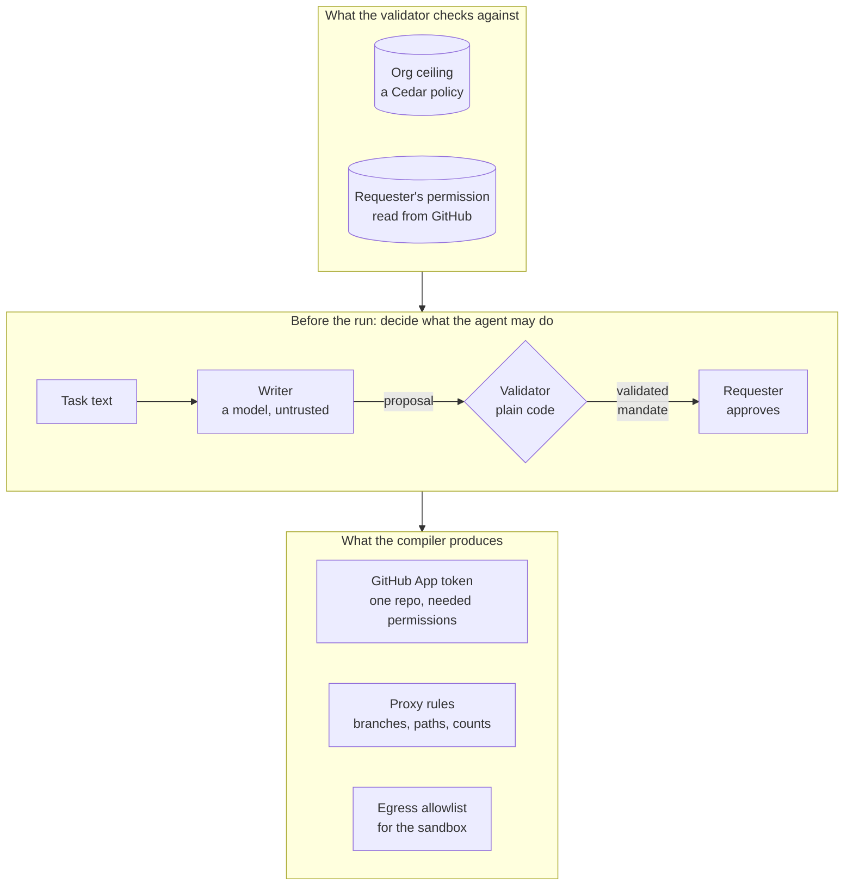
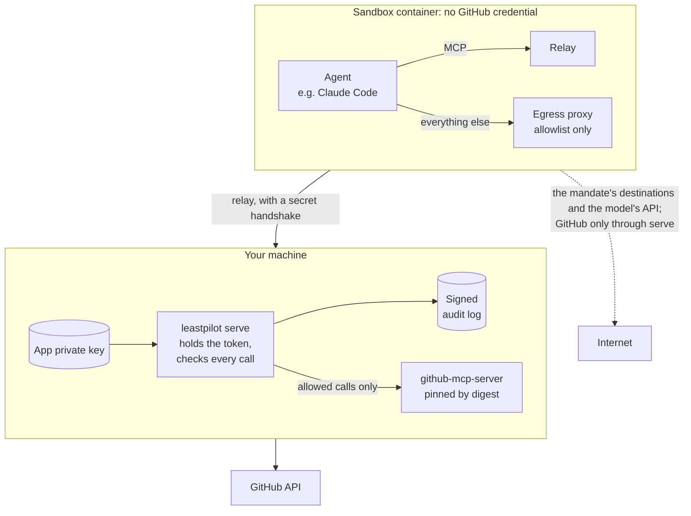

# LeastPilot

**LeastPilot gives an AI coding agent only the access its current task needs, and enforces that while the agent runs.**

Tell it the task, say *"Fix issue #42 and open a PR"*, and it writes down
exactly what that task is allowed to touch: which repository, which branches
and files, which actions, where data may go, and when it all expires. That
written-down permission slip is called a **mandate**. A plain rule-based
checker (no AI involved) proves the mandate doesn't go beyond what the person
asking and the organization already allow. Then LeastPilot hands the agent a
GitHub token limited to that one repository, puts a proxy between the agent
and GitHub that checks every call against the mandate, and records everything
it decided.

---

> ### Status: built, measured, not on npm yet
>
> The whole loop runs from one command: write a mandate, check it, get it
> approved, mint a scoped token, run the agent under it in a locked-down
> container, and keep a signed log. Version 0.2.0 is ready to publish to npm
> as [`@leastpilot/cli`](packages/cli/README.md) but **hasn't been published
> yet**, so for now you build it from this repository.
>
> It's been measured on six synthetic tasks, not the fifty the plan called
> for, and it **misses three of its targets**: task completion, how long
> writing a mandate takes, and how much it cuts a token's access when the
> token was already limited to one repository. See [Benchmark](#benchmark),
> and the [benchmark report](docs/benchmark-report.md), which lists its own
> shortfalls before any number.
>
> The project was called Mandate until 2026-10-12. The product, the
> `leastpilot` command, the `@leastpilot/*` packages and the `LEASTPILOT_*`
> variables are new names. The thing it writes is still called a mandate.

---

## Why this exists

Coding agents usually run with far more access than any one task needs.
Today's ways of limiting them each fall short:

1. **Broad credentials.** Agents tend to run on a developer's personal token
   or a wide GitHub App install. An agent fixing one issue can often merge
   pull requests, edit CI workflows, read secrets or touch other repositories.
2. **Policies written once.** Tools like GitHub's MCP toolsets or GitHub
   Agentic Workflows let you write limits per agent or per workflow. Those are
   either too loose for most tasks or too tight for some.
3. **Asking a model to judge.** Some products ask a language model, during the
   run, whether an action fits the task. A model can be talked out of its
   answer, and its decisions are hard to audit.

LeastPilot writes limits **per task**, checks them with ordinary code, and
enforces them with controls GitHub already has (scoped App tokens) plus a
proxy in front of GitHub's MCP server.

It does **not** try to detect prompt injection. It assumes an agent can be
tricked, and limits what a tricked agent can do.

## How it works

Here's the mandate for *"Fix issue #42 and open a PR"*:

```yaml
mandate: fix-issue-42
task: "Fix issue #42 and open a PR"
requestedBy: user:alice        # the person asking, never the agent
expiresInMinutes: 60
ceiling: org-policy@v12        # the org policy it must fit inside
grants:
  - action: repo.read
    enforcedBy: token
    resources: ["acme/api"]
  - action: contents.write
    enforcedBy: proxy
    resources: ["acme/api"]
    branches: ["agent/42-*"]
    paths: ["src/**"]
    denyPaths: [".github/workflows/**", "**.env**"]
  - action: pull_request.create
    enforcedBy: proxy
    resources: ["acme/api"]
    branches: ["agent/42-*"]
    base: main
    max: 1
destinations:
  allow: ["github.com/acme/api"]
```

Anything not granted is denied. So this agent can read `acme/api`, write
under `src/` on its own `agent/42-*` branch (never a CI workflow or a `.env`
file), and open one pull request into `main`. It can't merge, can't touch
another repository, and can't send repository data anywhere but that
repository.

A task goes through these steps:

- **Write.** A model reads the task and proposes a mandate. It's treated as
  untrusted: its output is a *proposal*, and only the validator can turn a
  proposal into something the rest of the system will accept. You can also
  write a mandate by hand.
- **Validate.** Plain code checks the proposal against two limits: the
  organization's **ceiling** (a policy file the operator writes, in
  [Cedar](https://www.cedarpolicy.com/)) and the requester's real permission
  on the repository, read from GitHub. It also rejects risky shapes outright,
  like writing to the default branch or touching workflows and secrets. If a
  grant is too wide, the error names the ceiling rule it broke and gives an
  example it would have allowed.
- **Approve.** The requester reads a permission diff of what's being granted.
  If you ask for it (`--approval`), nothing is minted until they approve that
  exact mandate by posting `/leastpilot approve <digest>` on the issue.
- **Mint.** LeastPilot creates a GitHub App token limited to the one
  repository and the permissions the grants need, expiring within the hour.
- **Run.** The agent's only route to GitHub is `leastpilot serve`, an MCP
  server that hides the tools the mandate doesn't grant and checks every call's
  repository, branch, base, file paths, destinations and count. A refused call
  names the rule it hit.
- **Widen.** If the mandate turns out too narrow, a refused call can be turned
  into a request for more scope. That request goes back through the validator
  and the requester, never the agent.
- **Expire and log.** The token is revoked at the end, and every call and
  decision is recorded, optionally in a signed log.

Two things about the checks matter more than they look:

- **The validator checks whole patterns, not examples.** A grant like
  `branches: ["agent/42-*"]` stands for every branch name that matches it.
  Checking a few sample names would prove nothing about the rest, so the
  validator turns each pattern into a small state machine and proves one
  pattern's matches are a subset of the other's. That's why a refusal can
  hand you a specific counterexample.
- **A GitHub token can't limit branches or files.** An App token can be
  limited to a set of repositories and permissions, and nothing finer. So
  every grant records what actually enforces it (`token`, `proxy` or
  `sandbox`), and [docs/enforced-where.md](docs/enforced-where.md) lists what
  each layer covers and what gets around it.

## System design

Two halves: everything that happens before the agent starts decides what it
may do, and everything during the run holds it to that.



The line that matters is the validator. Everything above it is untrusted:
task text, issue bodies, the model's proposal, an agent's plan. Everything
below it only accepts a *validated* mandate, and the only code that can
create one is the validator. That's enforced by the type system and by a lint
rule, not by convention.

Here's a run in the sandbox. The agent's container holds no GitHub credential
at all, and its only way out to the internet is an allowlist:



Why the sandbox matters: the proxy only sees MCP calls. An agent with a shell
could run `git push` or `curl` directly, or find a token somewhere on disk,
and never touch the proxy. In the sandbox the agent works in a clean clone of
your repository (no `.git/config`, no ignored `.env`), gets only the
environment variables you name, and can only reach hosts on the allowlist.
`iptables` rejects everything else, over IPv4 and IPv6, and if those rules
can't be loaded the container exits instead of starting the agent. Without `--sandbox`, the
agent runs as your user and could read the App's private key, so destination
limits are advisory. [docs/threat-model.md](docs/threat-model.md) §3.1 goes
through this.

The code is split into small packages, with the validator in the middle:

| Package | What it does |
| --- | --- |
| `@leastpilot/catalog` | 46 GitHub operations. For each: the REST route, the MCP tool, the App permission it needs, and how risky it is. Just data. |
| `@leastpilot/schema` | The mandate format, hashing, and the "validated" type only the validator can create. |
| `@leastpilot/validator` | The subset proofs, the Cedar ceiling, and the lints for risky mandates. |
| `@leastpilot/writer` | The model that proposes a mandate. Untrusted by design. |
| `@leastpilot/compiler` | Mints and revokes the scoped token, and turns a mandate into proxy rules, the egress allowlist and the gh-aw export. |
| `@leastpilot/proxy` | The MCP proxy: hides ungranted tools, checks every call, records decisions, and writes the signed audit log. |
| `@leastpilot/replay` | Replays a recorded run against a mandate and reports what it over- or under-granted. |
| `@leastpilot/cli` | The `leastpilot` command, and the sandbox's source. |
| `@leastpilot/bench` | Private. The benchmark. |

More detail on how they fit together: [docs/architecture.md](docs/architecture.md).

## Install

Not on npm yet. Until 0.2.0 is published, build from a checkout. You'll need
Node 22.12 or later and pnpm:

```bash
git clone https://github.com/pkravella/mandate
cd mandate
pnpm install && pnpm build
```

The examples below call `node packages/cli/dist/index.js`, which is the
`leastpilot` command. Running an agent in the sandbox also needs Docker
Desktop on macOS.

## Try it

**Check a mandate, offline and free.** Save the example above as
`mandate.yaml`, then:

```bash
node packages/cli/dist/index.js validate mandate.yaml \
  --ceiling fixtures/ceilings/org-policy-v12.cedar \
  --schema  fixtures/ceilings/schema.cedarschema \
  --ceiling-destinations fixtures/ceilings/org-policy-v12.destinations \
  --as alice --level push
```

It prints a permission diff and exits 0 if the mandate fits. If it doesn't,
you get exit 1 and something like this:

```
Mandate rejected.

  [not-contained] in grant #0 (contents.write) grant contents.write is wider
    than ceiling clause allow-agent-branch-writes: it would permit "feature/42-"
      ceiling clause: allow-agent-branch-writes
      counterexample: feature/42-

Nothing was minted. Narrow the mandate, or request a ceiling change.
```

`--level push` *asserts* Alice's permission, and the output says so every
time. To check it for real, use `--repo acme/api` instead, which reads it from
GitHub using your App's credentials (`LEASTPILOT_APP_ID`,
`LEASTPILOT_INSTALLATION_ID`, `LEASTPILOT_APP_KEY_PATH`). Only that version
counts as a record of who was allowed to do what. There's no default, so you
always pick one.

**Run an agent under a mandate.** `leastpilot run` checks the mandate, writes
an MCP config pointing at `leastpilot serve`, and starts whatever agent you
give it. `{mcpConfig}` is replaced with that config's path:

```bash
node packages/cli/dist/index.js run \
  --mandate mandate.yaml \
  --ceiling fixtures/ceilings/org-policy-v12.cedar \
  --schema  fixtures/ceilings/schema.cedarschema \
  --ceiling-destinations fixtures/ceilings/org-policy-v12.destinations \
  --as alice --repo acme/api --trace run.jsonl --diff \
  -- claude --mcp-config '{mcpConfig}' -p "Fix issue #42 and open a PR"
```

LeastPilot doesn't drive any particular agent. Every MCP client already knows
how to start a server from a config, so being that server is the whole
integration.

**Run it in the sandbox.** Build the base image, then an image with your agent
in it, then add `--sandbox`:

```bash
node packages/cli/dist/index.js sandbox build
docker build -t mandate-agent-claude packages/cli/sandbox/examples/claude-code
export CLAUDE_CODE_DISABLE_NONESSENTIAL_TRAFFIC=1

node packages/cli/dist/index.js run --mandate mandate.yaml \
  --ceiling fixtures/ceilings/sandbox-v1.cedar \
  --schema  fixtures/ceilings/schema.cedarschema \
  --ceiling-destinations fixtures/ceilings/sandbox-v1.destinations \
  --as pkravella --repo pkravella/mandate-sandbox \
  --sandbox --image mandate-agent-claude --agent-egress api.anthropic.com \
  --pass-env ANTHROPIC_API_KEY --pass-env CLAUDE_CODE_DISABLE_NONESSENTIAL_TRAFFIC \
  -- claude -p "read src/retry.js and say what it does" \
     --mcp-config '{mcpConfig}' --strict-mcp-config --allowedTools mcp__github
```

`--agent-egress` opens the agent's own model API, and `--pass-env` passes its
key by name. Both are your choice and are printed in the output; a mandate can
never ask for them. Ctrl-C stops the container, then revokes the token, then
removes the workspace. This was verified live with Claude Code: the allowed
read worked, a read of another repository was refused, and the only traffic
out was to the model's API.

The [quickstart](docs/quickstart.md) walks through all of this step by step.

## The rest of the loop

**Approvals.** `--approval owner/repo#42` on `run` or `serve` refuses to mint
a token until the requester has posted `/leastpilot approve <digest>` on that
issue or pull request. The digest covers the mandate, the ceiling it was
checked against, and who asked, so a mandate edited after review needs a new
approval. Only the requester's own, unedited comment counts.

**Asking for a mandate in a comment.** `leastpilot review` writes a mandate
for a task and posts the permission diff on the issue, with the exact line
that approves it. Because a model call costs money and anyone can comment, it
checks the requester's permission, an hourly limit per repository and the
task's length before it calls the model.
[examples/workflows/leastpilot-review.yml](examples/workflows/leastpilot-review.yml)
wires this up so `/leastpilot <task>` posts a review and the requester's
approval runs the agent.

**Widening.** Run `serve` or `run` with `--pauses <dir>` and every refused
call is saved there, along with the command to ask for more scope.
`leastpilot widen` applies that request and re-checks the whole mandate from
scratch. Some refusals can't be widened on purpose: a denied path, an expired
mandate, an operation that wasn't granted at all, or a disallowed destination.
A one-click "allow `.github/workflows/**`" would make the deny list pointless.

**Audit log.** `--audit-log <path>` writes a signed, append-only record of the
session: the mandate, every call sent to GitHub, every decision, and a final
seal. Each line is signed with its own Ed25519 key (`leastpilot audit keygen`)
and chained to the one before. `leastpilot audit verify` checks it with only
the public key. The signature only means something against the agent when the
agent runs in the sandbox, because otherwise it could read the key.
[docs/audit-log.md](docs/audit-log.md) has the details.

**Exporting to GitHub Agentic Workflows.** `leastpilot export gh-aw` turns a
checked mandate into a [gh-aw](https://github.github.com/gh-aw/) workflow,
where the agent runs read-only and gh-aw's own job does the writing within the
mandate's limits. It refuses anything gh-aw can't hold exactly, rather than
quietly loosening it. [docs/gh-aw.md](docs/gh-aw.md) has the mapping.

**The GitHub Action.** There's an [Action](action.yml) and an
[example workflow](.github/workflows/leastpilot.yml). It builds LeastPilot
from source on every run for now (about a minute), since the CLI isn't on npm
yet. The workflow sets `permissions: {}` and the Action refuses to run if it
finds a `GITHUB_TOKEN`, since a second credential is access no mandate limits.
It takes the agent command one argument per line, so no workflow input is ever
run through a shell.

## Benchmark

Six synthetic tasks against a test repository, each run under its generated
mandate. One run per task per mode, so the numbers are noisy. The
[full report](docs/benchmark-report.md) is generated from committed results,
and a test re-renders it to make sure they still match.

| Metric | Result | Target |
| --- | --- | --- |
| Tasks completed | 83.3% (5 of 6) | at least 90% |
| Access cut at the token, vs. a token for 1 repository | 32.3% | at least 80% |
| Access cut at the proxy, vs. a token for 1 repository | **87.1%** | at least 80% |
| Access cut at the token, vs. a developer's token (63 repositories) | 98.9% | at least 80% |
| Access cut at the proxy, vs. a developer's token (63 repositories) | 99.8% | at least 80% |
| Granted but never needed | **0.0%** | under 10% |
| Runs paused for something in scope, tools hidden | 0.0%, but see below | under 5% |
| Runs paused for something in scope, every tool offered | 66.7% (4 of 6, 3 of which still finished) | under 5% |
| Time to write a mandate | ~10.2 s at effort `medium` (13.0 s at `high`) | under 10 s |
| Grants outside the ceiling, including 42 attack cases | 0 | 0 |

How to read these:

- **The 63-repository numbers flatter it.** Nearly all of that cut comes from
  limiting the token to one repository, which any scoped token gets without
  LeastPilot. Per repository, LeastPilot takes a task from 31 operations down
  to 21 at the token and 4 at the proxy.
- **Zero pauses doesn't mean the mandates were the right size.** The proxy
  hides tools the mandate doesn't grant, so the agent never tries them and
  nothing gets refused. Replay of unconstrained runs predicted seven calls the
  mandates were missing, yet the proxy refused nothing. So the benchmark also
  runs each mandate with every tool visible. That turned up five refusals. Four
  were redundant reads of an issue the agent already had. The fifth was real:
  the triage task's mandate didn't grant commenting, so the agent couldn't
  report what it found, and that task failed.
- **Writing a mandate** costs about $0.03 and takes two model calls. Effort
  `medium` gave the same mandates as `high` on all six tasks, and on the five
  tasks written at both settings every `medium` write was faster, a median of **10.4 seconds** against 11.7 (10.2 across all six), so `medium` is the
  default. It still misses the ten-second target
  ([writer-effort-results.json](docs/writer-effort-results.json)).

The attack suite is separate from the benchmark: 42 cases where injected issue
text, hostile tool descriptions, over-asking agent plans or tricky arguments
try to widen what the agent can do. Each case assumes the model writing the
mandate was **fully fooled** and proposed exactly what the attacker wanted. The
question is only whether the validator and the proxy refused it anyway. They
did in every case.

## Commands

| Command | What it does |
| --- | --- |
| `leastpilot validate` | Check a mandate against the ceiling and the requester's permission, and print the permission diff |
| `leastpilot run` | Check a mandate, then start an agent whose only route to GitHub is the enforcing proxy (`--sandbox` to run it in a container) |
| `leastpilot serve` | The enforcing MCP server for one mandate, which is what an agent's MCP config starts |
| `leastpilot review` | Write a mandate for a task and post its permission diff on an issue or pull request |
| `leastpilot reviewed` | Recover the mandate an approval digest names, from the review comment |
| `leastpilot widen` | Apply a request for more scope and re-check the whole mandate |
| `leastpilot export gh-aw` | Turn a checked mandate into a GitHub Agentic Workflows workflow |
| `leastpilot audit keygen` / `verify` | Make an audit-log signing key, and check a log |
| `leastpilot sandbox build` | Build the sandbox's base image from the source in the package |

## What it doesn't do

- **Detect prompt injection.** It limits what a tricked agent can do instead.
- **Protect you from another credential.** If the agent can find a personal
  token, a logged-in `gh`, or an SSH key, it doesn't need the proxy. That's
  what the sandbox is for.
- **Ask a model whether an action is OK.** A model proposes; plain code
  decides.
- **Be an identity provider, a secrets vault, or another MCP gateway.**
- **Work outside GitHub**, for now.

## Known gaps

Stated here so nobody has to discover them:

- **No auto-approval.** Every mandate needs a person to approve it. There's no
  library of task templates yet for an org to mark as safe to auto-approve.
- **Requests from automation accounts are refused.** GitHub only tells an App
  what another App may do, so LeastPilot has no way to check an `app:`
  requester's access.
- **One export backend out of four.** gh-aw works. Docker MCP Gateway, AWS
  AgentCore (Cedar) and OPA exports don't exist yet.
- **Thirteen catalog operations have no MCP tool,** so the proxy never sees
  them. Most are classed as forbidden and rejected by the validator;
  `branch.delete` is the one to watch.
- **The sandbox is macOS with Docker Desktop only.** The Linux path has never
  been run, so `--sandbox` refuses there, including on GitHub's runners.
- **`max` counts per session, not per task.** A new session starts from zero.
  With `--sandbox` only you can start one; without it, the agent could.
- **The audit log has no outside witness.** A log with no seal was cut off,
  and nothing in it can say how.
- **Six tasks, not fifty.** A fifty-task run would cost about $14 plus
  recording reference runs, and the project's budget was $10.

The full list of what breaks it is in [docs/threat-model.md](docs/threat-model.md) §3.

## Prior work

| Project | What it does | What LeastPilot adds |
| --- | --- | --- |
| [IntentCap](https://arxiv.org/abs/2609.14631) | Model-written capability leases, a checker that only narrows, MCP and eBPF enforcement | The closest design. LeastPilot is a maintained tool with GitHub's semantics and replay measurement |
| [Progent](https://github.com/sunblaze-ucb/progent) | A policy language and a model-written policy per task | An org-level ceiling, expiry, and GitHub-native enforcement |
| [Conseca](https://arxiv.org/abs/2501.17070) | Per-task policy from trusted context, checked deterministically | Released code |
| [AWS AgentCore Policy](https://docs.aws.amazon.com/bedrock-agentcore/latest/devguide/policy.html) | Plain English to Cedar, formally checked, enforced at AgentCore Gateway | Policy per task rather than per agent, and it works outside AWS |
| [GitHub Agentic Workflows](https://github.github.com/gh-aw/reference/safe-outputs/) | A read-only agent that writes through limited safe outputs | Limits per task instead of per workflow; LeastPilot can export to it |
| [Invariant Guardrails](https://explorer.invariantlabs.ai/docs/guardrails/dataflow-rules), [FIDES](https://github.com/microsoft/fides) | Deterministic data-flow rules | Derives the rules from the task instead of writing them by hand |

The npm scope is `@leastpilot`. `@mandate` and `mandate-dev` belong to
unrelated projects, which is part of why the name changed.

## Security

The [threat model](docs/threat-model.md) says what holds, what's out of scope
and what breaks it. Short version for operators: run agents with `--sandbox`,
use `--repo` rather than `--level`, require an approval, give the job no
`GITHUB_TOKEN`, and never paste issue text into the agent's prompt. Pass the
issue number and let the agent fetch it through its granted tools.

To report a security problem in LeastPilot itself, see [SECURITY.md](SECURITY.md).

## Documentation

| | |
| --- | --- |
| [Quickstart](docs/quickstart.md) | Check a mandate, then run an agent under it |
| [Mandate format](docs/mandate-format.md) | Every field, and what gets rejected |
| [Writing a ceiling](docs/ceiling-authoring.md) | The org policy file and the subset of Cedar it uses |
| [Enforced where](docs/enforced-where.md) | Which control enforces what, and what gets around each one |
| [Threat model](docs/threat-model.md) | What holds, what's out of scope, what breaks it |
| [Audit log](docs/audit-log.md) | Turning it on, checking it, and what the signature proves |
| [gh-aw export](docs/gh-aw.md) | What maps to GitHub Agentic Workflows and what's refused |
| [Architecture](docs/architecture.md) | How the packages fit together, and why |
| [Benchmark report](docs/benchmark-report.md) | The full measurements, generated from [the results](docs/benchmark-results.json) |
| [Releasing](docs/releasing.md) | How the packages get to npm |

## Development

```bash
pnpm install
pnpm typecheck   # builds, then typechecks the tests
pnpm lint        # includes the rules that guard the validator boundary
pnpm test
pnpm build
```

About 1,450 tests run offline with no credentials, and that's what CI runs.
Use the root `pnpm build`: the packages have no build script of their own, so
`pnpm --filter <pkg> build` does nothing and still exits 0.

Fifty-two more tests are switched off by default, each behind its own
variable, because they spend money, use real credentials, write to a real
repository, or need Docker. CI never runs them and needs no secrets.

| Variable | What it runs | Cost |
| --- | --- | --- |
| `LEASTPILOT_LIVE=1` | The writer against the real model, real token minting, and the whole loop end to end | ~$0.03 to ~$0.30 |
| `LEASTPILOT_SANDBOX=1` | Builds the sandbox and checks its egress, the relay, and `run --sandbox` end to end, each with a control that shows the check can fail | free, needs Docker |
| `LEASTPILOT_SEED=1` | Seeds the benchmark tasks into the test repository: **writes to its default branch and opens issues** | free |
| `LEASTPILOT_GROUND_TRUTH=1` | Re-records the reference runs, **overwriting the committed ones** | ~$3 |
| `LEASTPILOT_BENCH=1` | The benchmark sweep and the report | ~$1.80 for six tasks |
| `LEASTPILOT_WRITER_SWEEP=1` | Rewrites each task's mandate at several effort settings and compares | ~$0.03 a write |

The ones that use credentials also need `ANTHROPIC_API_KEY`,
`LEASTPILOT_APP_ID`, `LEASTPILOT_INSTALLATION_ID`, `LEASTPILOT_APP_KEY_PATH`
and `LEASTPILOT_TEST_REPO`. See [CONTRIBUTING.md](CONTRIBUTING.md), in
particular the one rule that isn't negotiable.

## License

[Apache-2.0](LICENSE). See [NOTICE](NOTICE) for attribution.
